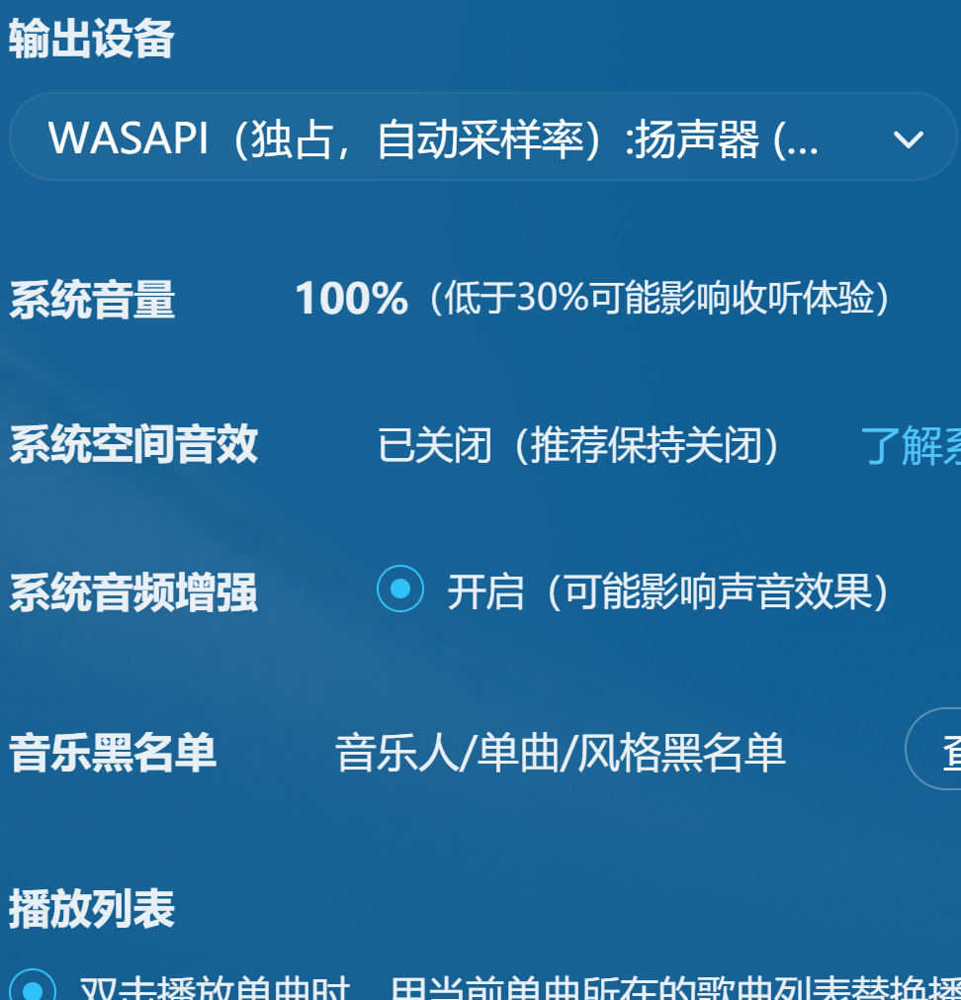
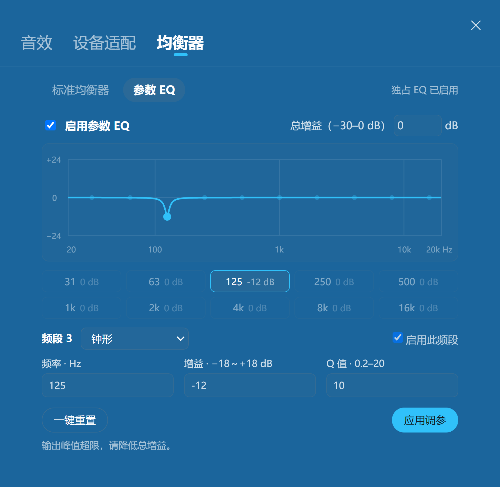

# 网易云输出扩展 · NcmWasapiExtension

为网易云音乐 Windows 客户端添加 **WASAPI 共享 / 独占输出**和 **10 段参数 EQ**。

当前版本 **0.7.0-preview.10** 修复播放中切换高清臻音、超清母带时 DAC 采样率未跟随的问题。完整更新与实测范围见[发行说明](docs/releases/v0.7.0-preview.10.md)。

**一个安装包，装好后照常打开原来的网易云音乐。** 输出模式在客户端内选择，EQ 融入原生均衡器窗口。

[下载安装](#下载安装) · [选择输出](#选择输出) · [参数-eq](#参数-eq) · [更新与卸载](#更新与卸载) · [常见问题](#常见问题)

## 下载安装

需要 **Windows 10 / 11 x64**、**64 位网易云音乐**，以及对应声卡 / DAC 的驱动。运行组件已包含，无需另装 Python。

1. 打开 [Releases 下载页](https://github.com/tutomato/NcmWasapiExtension/releases)，在 Assets 中下载 `…-windows-x64-setup.exe`。最新源码的构建产物也可从 [Actions](https://github.com/tutomato/NcmWasapiExtension/actions/workflows/build-release.yml) 中成功完成的构建下载。
2. **完全退出网易云，包括托盘图标**，运行安装包并允许管理员安装。
3. 在“选择网易云音乐”页面确认你平时使用的 `cloudmusic.exe`；未自动找到时，点击 **Browse…（浏览）**选择。
4. 接受许可，点击 **Install（安装）**，完成后照常从原网易云图标启动。

共享 / 独占输出和参数 EQ 会一起安装，不需要另开启动器或安装第二个插件。`portable.zip` 仅解压不会安装自动加载；普通用户选择 `setup.exe` 即可。

> 如果网易云目录存在 BetterNCM 等其他插件的 `msimg32.dll`，安装器会提示冲突并停止。请先通过原插件的卸载方式解决冲突。

## 选择输出

进入 **设置 → 播放 → 输出设备**，选择设备名称对应的输出方式。

| 输出方式 | 用途 |
| --- | --- |
| **WASAPI（共享）** | 网易云、浏览器等程序可同时通过同一设备发声 |
| **WASAPI（独占，自动采样率）** | 独占所选设备，优先跟随网易云音频处理链请求的采样率输出；支持本扩展的参数 EQ |



*真实客户端截图；设备名称随电脑变化。点击图片可查看原图。*

连接新 DAC / 声卡后会自动扫描设备与格式能力，确认支持后提供相应选项。若未出现，等待列表更新后重新展开；必要时完全退出网易云再打开。

独占时其他程序可能无法通过同一设备发声，需要混合播放时切回共享。采样率与输出格式取决于歌曲、客户端音频管线及设备驱动。

## 参数 EQ

### 打开与启用

1. 选择 **WASAPI（独占，自动采样率）**输出。
2. 在播放栏点击 **“…” → 音效 → 均衡器 → 参数 EQ**。
3. 勾选 **启用参数 EQ**，立即启用已保存的参数。

启用后，播放栏会显示 **参数 EQ**，点击可直接回到参数 EQ 页面。


### 调整参数

点击频段或曲线上的圆点，选择要调整的频段，再编辑下方参数。



*图中为 125 Hz、−12 dB、Q=10 的钟形滤波示例，不是通用推荐设置。*

| 控件 | 作用 |
| --- | --- |
| **启用参数 EQ** | 勾选 / 取消立即生效，不提交尚未应用的调参草稿 |
| **频率** | 要调整的中心 / 转折频率，20–20000 Hz |
| **增益** | 当前频段提升或衰减，−18～+18 dB |
| **Q 值** | 控制滤波宽度，0.2–20；钟形滤波的 Q 越大，作用范围越窄 |
| **滤波类型** | 钟形、低音搁架或高音搁架 |
| **启用此频段** | 决定该频段是否参与处理，点击“应用调参”后生效 |
| **总增益** | 整体电平，−30～0 dB；可降低它为 EQ 处理预留余量 |
| **应用调参** | 保存并应用参数修改，不改变 EQ 总开关 |
| **一键重置** | 立即恢复默认频率、Q=1、所有增益为 0 dB，保持总开关状态 |

曲线随编辑即时预览，**参数修改点击“应用调参”后才改变声音**。超出范围的输入会自动校正并提示。若提示输出峰值超限，可适当降低总增益。

参数 EQ **仅对本扩展的独占输出生效**。与标准均衡器互斥；其他网易云音效请手动关闭，避免叠加。可点击“标准均衡器”查看原生界面；切换页面本身不等于启用对应 EQ。

## 更新与卸载

**更新：** 完全退出网易云，运行新版 `setup.exe` 覆盖安装，仍关联同一个 `cloudmusic.exe`。无需先卸载；个人 EQ 参数保留。目前不提供自动更新。

**卸载：** 完全退出网易云，在 Windows **设置 → 应用**中搜索 **网易云输出扩展**并卸载，然后重新打开网易云。

卸载会同时移除输出扩展和参数 EQ，保留网易云客户端、歌单与音乐。个人配置和日志默认保留在 `%LOCALAPPDATA%\NcmWasapiExtension`；EQ 配置为其中的 `equalizer.json`。

## 常见问题

**没有独占选项 / 设备无声？** 先确认安装关联的是当前客户端，并检查设备驱动及是否被其他播放器占用。尝试切回共享、重新选择设备，或完全退出后重开网易云。

**换设备后无法播放？** 等待设备列表更新再选择新设备；音频管线未恢复时重启网易云。

**网易云更新后不能用了？** 扩展按内部结构自动检测兼容性，不按完整版本号锁定。若更新移除了加载文件，或改变了音频 / 界面接口，运行新版扩展安装包重新检测。真实播放实测基线为网易云 `3.1.42.205594 x64`；自动检测不代表所有未来版本都已验证。详见[兼容性说明](docs/COMPATIBILITY.md)。

**独占输出是否等于原始音频逐位直通？** 独占绕过 Windows 共享混音，但网易云自身的音量、音效和重采样仍可能影响信号。本项目不承诺逐位一致，也不提供 VST 插件宿主。

遇到问题请在 [Issues](https://github.com/tutomato/NcmWasapiExtension/issues) 提供扩展版本、网易云完整版本、设备 / 驱动、输出模式和复现步骤。日志位于上述配置目录，分享前请检查设备标识与个人路径。

## 开发与许可

在 Windows x64、PowerShell 中，于仓库根目录运行：

```powershell
powershell.exe -NoProfile -File .\scripts\build.ps1
```

构建工具与依赖按锁定文件下载并校验，产物位于 `dist/`。详见[构建与发布](docs/RELEASING.md)。安装包如需校验，请将 SHA256 与同次 Release 的 `SHA256SUMS.txt` 对照。

项目代码采用 [MIT](LICENSE) 许可；随包组件见[第三方声明](THIRD_PARTY_NOTICES.md)。本项目非网易云官方产品，发行包不包含网易云客户端或用户音乐。
