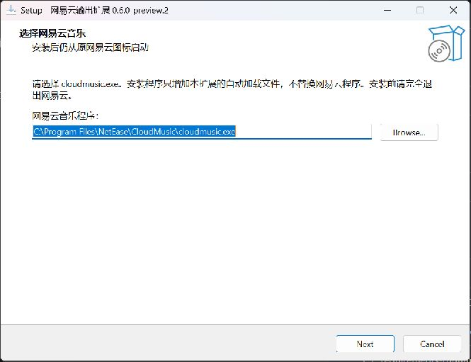
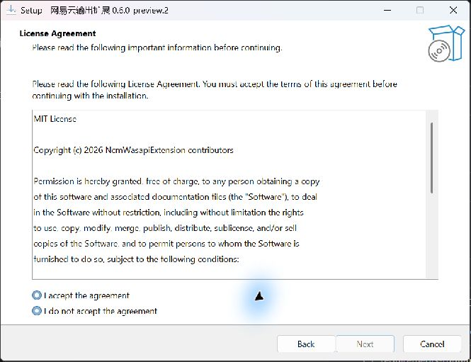
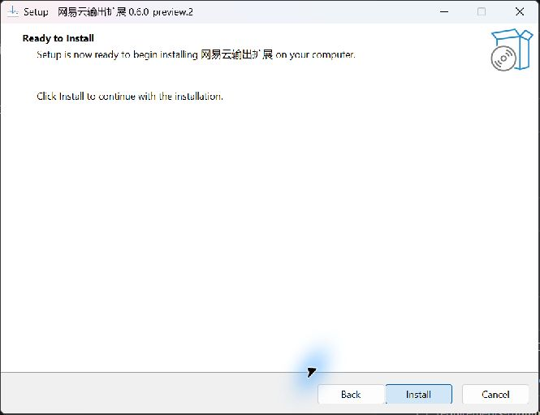
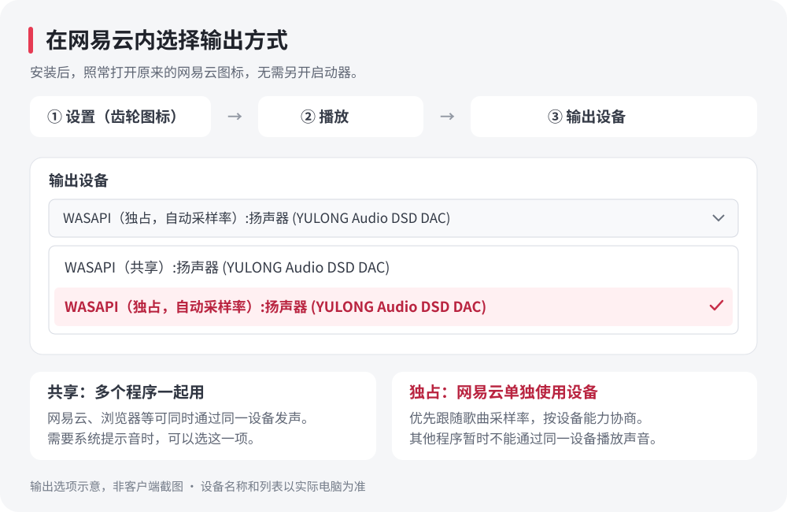
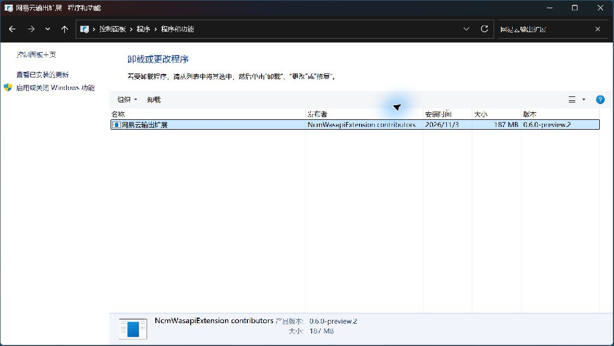

# NcmWasapiExtension

在网易云音乐 Windows 客户端的输出设备列表中添加 **WASAPI 共享与独占选项**，继续使用原客户端选歌、播放和调节音量。

**安装后，照常打开原来的网易云图标。** 扩展随客户端自动加载，不需要另开启动器。

当前为实验版本 `0.7.0-preview.5`。**WASAPI 共享 / 独占输出与参数 EQ 属于同一个“网易云输出扩展”**，共用一个安装程序、一次覆盖升级和一个卸载入口；不用另外安装 EQ 插件。

[安装](#安装) · [使用](#使用) · [更新](#更新) · [卸载](#退出与卸载) · [常见问题](#常见问题)

## 安装

### 1. 下载正确的安装包

需要 **Windows 10 / 11 x64** 和 **64 位网易云音乐**。Python 和运行组件已经包含，无需另外安装。

打开 [Releases 下载页](https://github.com/tutomato/NcmWasapiExtension/releases)，在对应版本的 **Assets** 中下载：

| 文件 | 用途 |
| --- | --- |
| `NcmWasapiExtension-…-windows-x64-setup.exe` | **推荐：安装、更新扩展** |
| `SHA256SUMS.txt` | 核对同次发布的下载文件 |
| `…-windows-x64-portable.zip` | 手动运行、调试或部署工具使用；仅解压不会安装自动加载 |
| `…-source.zip` / `Source code` | 开发者使用的源码，普通安装无需下载 |

首次尝试可以选择标有 **Pre-release** 的实验版本。请核对安装包版本；0.6 系列不包含参数 EQ。对应版本入口：[v0.7.0-preview.5](https://github.com/tutomato/NcmWasapiExtension/releases/tag/v0.7.0-preview.5)。最新源码构建产物也可从本仓库 Actions 下载。

### 2. 完全退出网易云，选择客户端位置

先退出网易云。如果关闭窗口后通知区域仍有网易云图标，请从托盘菜单中退出，再运行下载的 `setup.exe` 并允许管理员安装。

在“**选择网易云音乐**”页面，确认路径指向你平时使用的 `cloudmusic.exe`。如果没有自动找到，点击 **Browse…（浏览）** 手动选择。这里选择的是网易云主程序，路径应以 `cloudmusic.exe` 结尾。



找不到程序位置时，可以右键原网易云快捷方式，使用“**打开文件所在的位置**”查找。扩展安装到哪里与网易云装在哪里是两件事：此页用于关联原网易云客户端。

### 3. 完成安装

点击 **Next（下一步）** 进入 **License Agreement（许可协议）**，阅读后选择 **I accept the agreement（接受协议）**，再点击 **Next**。



在 **Ready to Install（准备安装）** 页面确认信息，点击 **Install（安装）**，等待完成后点击 **Finish（完成）**。



向导部分按钮使用英文：

| 按钮 | 含义 |
| --- | --- |
| `Next` / `Back` | 下一步 / 上一步 |
| `Browse…` | 浏览，选择程序 |
| `Install` / `Finish` | 安装 / 完成 |
| `Cancel` | 取消 |

默认扩展安装位置为 `%ProgramFiles%\NcmWasapiExtension`。自动加载组件部署到所选网易云目录，因此安装、升级和卸载需要管理员权限。

如果网易云目录已存在 BetterNCM 或其他来源的 `msimg32.dll`，安装器会提示冲突并停止，不会覆盖它。请先通过原插件自己的卸载流程解决冲突，再安装本扩展。

### 可选：校验下载文件

在下载目录中执行：

```powershell
Get-FileHash -Algorithm SHA256 -LiteralPath '.\下载的安装包.exe'
```

将结果与**同次 Release** 的 `SHA256SUMS.txt` 对照。校验值用于检测文件差异，不等于发布者身份签名。当前构建默认不包含 Authenticode 签名；如某个发行版经过签名，以该版本的发布说明和签名证书为准。

## 使用

### 在网易云内选择输出方式

1. 安装完成后，打开你原来的 **网易云音乐** 图标或 `cloudmusic.exe`。
2. 进入 **设置 → 播放 → 输出设备**，展开输出列表。
3. 找到你的 DAC / 声卡，选择共享或独占选项，然后播放歌曲。



上图为**输出选项示意**，不是客户端截图。设备名和列表会随电脑变化，以 Windows 和设备驱动报告的名称、能力为准。

| 输出方式 | 适合的使用场景 |
| --- | --- |
| **WASAPI（共享）** | 希望网易云、浏览器等程序同时通过同一设备播放声音 |
| **WASAPI（独占，自动采样率）** | 希望网易云独占所选设备，优先跟随歌曲采样率输出 |

独占播放时，其他程序可能暂时无法通过**同一设备**发声。需要同时听到其他程序时，在网易云内切回共享即可，无需卸载扩展。

以后仍照常从原网易云启动。连接新设备后，扩展会扫描设备及格式能力并更新列表；只有确认能力后才提供相应的独占选项。如果设备刚接入后未出现，请等待列表更新并重新选择设备；必要时完全退出网易云再打开。

### 使用参数 EQ

1. 在输出设备列表中选择 **WASAPI（独占，自动采样率）**。
2. 播放栏右下角点击 **“…”更多操作 → 音效 → 均衡器 → 参数 EQ**。
3. 点击频段，编辑频率、增益、Q 和滤波类型，勾选“启用参数 EQ”，然后点击“应用并保存”。

参数 EQ 融入原生音效窗口，沿用皮肤配色；“标准均衡器”切回网易云原来的界面。原生音效总开关与参数 EQ 的启用开关分别控制各自处理，请关闭原有 EQ 和其他音效，避免叠加。

新配置默认总增益、各频段增益均为 **0 dB**。支持 10 段钟形 / 低音搁架 / 高音搁架；频段增益 −18～+18 dB、总增益 −30～0 dB、Q 0.2–20。界面显示范围，超界输入会调整并提示；小数及空白在结束编辑时校正。预览曲线随草稿更新，点击应用后才改变声音。

参数 EQ 仅在本扩展的独占输出中生效，共享 / DirectSound 不经过新 EQ。原采样率切换时按实际流采样率重新计算滤波系数。此版本没有 VST 插件宿主、动态 EQ 或线性相位模式。参数保存在 `%LOCALAPPDATA%\NcmWasapiExtension\equalizer.json`，升级和卸载默认保留个人设置。

## 更新

当前版本**没有自动更新器**。更新扩展时：

1. 完全退出网易云，包括托盘中的网易云。
2. 阅读新版发布说明，从 [Releases](https://github.com/tutomato/NcmWasapiExtension/releases) 下载新的 `windows-x64-setup.exe` 并运行。
3. 确认仍关联同一个 `cloudmusic.exe`，完成安装。
4. 照常打开原网易云，在 **设置 → 播放 → 输出设备** 中检查输出选项；参数 EQ 在原生“音效 → 均衡器”内检查。

从 0.6 系列升级到 0.7，直接运行同一个扩展的新安装包覆盖升级，不需要先卸载，也无需安装第二个插件。

不要在网易云运行时手动覆盖自动加载文件或运行组件。

网易云更新后，扩展会重新检测，内部结构仍兼容时可继续使用。如果更新改变了音频引擎或界面接口，扩展会停止接入并保持或恢复普通输出；此时更新扩展即可重新检测，无需手动挑选客户端版本。不要关闭结构或运行时校验来强行接管输出。

## 退出与卸载

如果只是暂时不用独占，在网易云输出列表中切回 **WASAPI（共享）** 即可。

需要移除扩展时：

1. **完全退出网易云**，包括托盘中的网易云。
2. 打开 **控制面板 → 程序 → 程序和功能**，此入口适用于 Windows 10 / 11。也可以使用 Windows **设置 → 应用 → 已安装的应用**；Windows 10 对应页面通常为“**应用和功能**”。
3. 搜索 **网易云输出扩展**，选中该条目并点击 **卸载**，按提示允许管理员操作并完成卸载。
4. 再次打开原网易云，使用客户端普通输出。



卸载的是 **网易云输出扩展**，会同时移除独占输出和参数 EQ。网易云客户端、账户、歌单、下载音乐和客户端缓存会保留。

卸载工具按本项目的归属记录核对自动加载文件，只移除本项目拥有的文件。未知或被其他程序修改的文件不会被当作本项目文件删除。扩展配置和日志位于 `%LOCALAPPDATA%\NcmWasapiExtension`，卸载默认保留。

## 常见问题

**没有独占选项或某个设备无法打开**：设备和驱动不一定支持所需格式，也可能被其他播放器占用。先尝试共享输出，重新选择设备；若仍无声，完全退出并重新打开网易云。安装时未通过兼容检测或存在自动加载文件冲突，也不会接入扩展。

**拔插设备后无法继续播放**：等待列表更新后重新选择设备。部分客户端音频管线在失败后需要重启网易云；扩展不会把这种情况报告成已经成功恢复。

**网易云更新后扩展停止启用**：可能是内部结构或接口检查未通过，也可能是客户端更新移除了本扩展的自动加载文件。完全退出网易云后，运行新版扩展安装包重新检测。参见[兼容性和升级规则](docs/COMPATIBILITY.md)。

提交问题时请提供扩展版本、客户端完整版本、设备 / 驱动名称、所选模式及状态中的源 / 输出采样率。日志可能包含本机设备标识和路径，分享前请检查；不要上传音乐文件、登录信息或完整用户配置。

## 功能与兼容性

- 在客户端内选择输出设备及共享 / 独占模式，包含系统默认输出。
- 独占输出优先使用歌曲采样率，并按设备能力选择 PCM 或浮点格式；实际输出信息显示在扩展状态中。
- 如果源采样率与设备输出采样率不同，状态会显示两者，例如 `44.1 → 48 kHz`。
- 扫描设备及格式能力，设备连接状态变化后更新列表。
- 保留网易云内的选歌、暂停、切歌和音量操作。
- 使用原来的网易云程序和快捷方式启动，自动增加输出选项。
- 网易云目录仅增加本扩展的自动加载文件，播放器主程序和原有库保留原文件。
- 自动检查客户端内部结构；位置或界面模块编号变化时重新识别，不依赖完整版本号白名单。

独占模式绕过 Windows 共享混音，不能由此推断网易云自身的音效、音量、重采样等处理也全部绕过。本项目不承诺逐位一致的输出，也不绕过歌曲权限或提供音乐解密、下载功能。

启动时自动检测客户端是否兼容。用户不用按网易云版本号选择插件，也不需要先降级；内部音频、界面及自动加载入口兼容时自动接入，检测不通过时保持或恢复普通网易云输出。

自动检测不代表任意未来版本都能使用。目前真实播放实测基线仍为网易云 `3.1.42.205594 x64`，其他位置和界面模块编号变化使用模拟数据验证。设备会按 Windows 驱动报告的能力协商格式，不代表所有客户端、声卡、DAC 和驱动组合均已逐一实测。详见[兼容性](docs/COMPATIBILITY.md)。

## 从源码构建

在 Windows x64 的 Windows PowerShell 5.1 或 PowerShell 7 中，于仓库根目录执行：

```powershell
powershell.exe -NoProfile -File .\scripts\build.ps1 -Version 0.7.0-preview.5
```

构建脚本按 `dependencies.lock.json` 下载并校验运行组件和工具；需要的 Python、Inno Setup 与原生加载器编译工具会在项目 `.build/` 缓存中准备。构建产物写入 `dist/`。构建、签名和 GitHub 发布流程见[发布说明](docs/RELEASING.md)。

## 许可与第三方组件

项目自行编写的代码采用 [MIT](LICENSE) 许可。随包运行组件保留各自许可；见[第三方声明](THIRD_PARTY_NOTICES.md)。

本项目不是网易云音乐官方产品，与网易云音乐及硬件厂商没有隶属关系。仓库和发行包不包含网易云客户端、客户端 DLL 或用户音乐。
